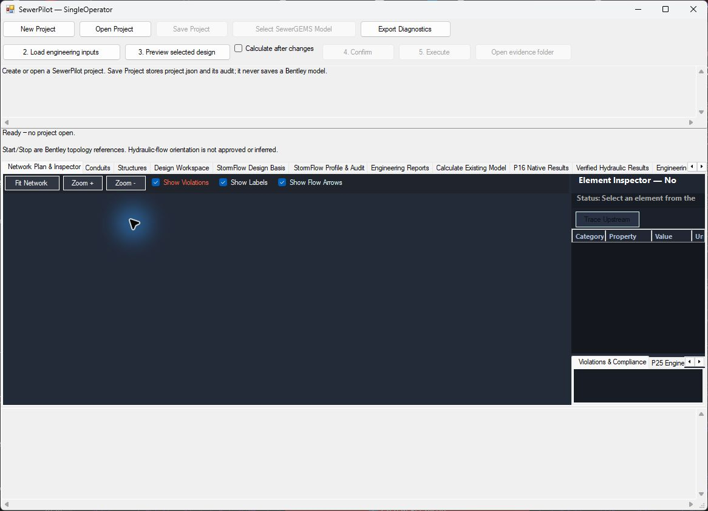

# SewerPilot

**A Windows engineering workspace for inspecting sewer and drainage networks, protecting source models, and verifying Bentley hydraulic results.**

## Overview

Hydraulic analysis involves more than running a solver: engineers must reconcile network properties, design criteria, scenario identity, calculation outputs and the evidence behind a decision. SewerPilot brings those tasks into a desktop workspace around Bentley OpenFlows Sewer / SewerGEMS.

SewerPilot provides workflow, design assistance, quality checks, auditing and reporting. **Bentley remains the native hydraulic solver.** Engineering authority comes from explicit project criteria, applicable standards, calculated results and responsible engineer decisions. Software acceptance does not certify a design for construction.

This repository is a public source snapshot exported on 2026-11-13. It includes application code, test harnesses, build scripts and technical documentation. Customer models, private acceptance archives, installers, Bentley components and the original development history are excluded.

## Key Features

- **Model intake and inspection:** select a supported SewerGEMS model, read its network, and inspect conduit and structure properties through tables, a 2D plan canvas and an element inspector. The workspace includes tracing and profile views.
- **Separate engineering workflows:** StormFlow provides stormwater design-basis, hydrology, inlet, conduit and reporting tools; GravityFlow provides gravity-network design preparation, feasibility checks and candidate workflows. Their criteria remain independent.
- **Saved-scenario calculation:** the desktop **Calculate Existing Model** workflow resolves the model's saved scenario, calculation options and native engine. It has been accepted on bounded reference configurations, rather than every possible model.
- **Source-model protection:** calculations and authorized design changes operate on isolated working copies. Before/after model-family fingerprints help detect unintended baseline changes.
- **Independent result readback:** calculation output is persisted, reopened in a separate process, and checked against scenario, engine, event and file-inventory identity before it is presented as verified output. Missing metrics remain explicitly unavailable.
- **Traceable review and support:** result receipts, design-basis and violation reports, decision registers and model audits support review. **Export Diagnostics** creates a local redacted support archive; it does not upload it.

## Application Screenshots



*Genuine, unmodified capture of the existing desktop application on 2026-11-14. The empty workspace shows the network plan, inspector, workflow controls and available tabs. No model or calculation result is shown.*

Existing populated result captures contain private paths or customer-model details and are excluded. No replacement results or reconstructed interfaces are used.

## Hydraulic Calculation Workflow

1. **Select the model.** Create or open a SewerPilot project, then choose **Select SewerGEMS Model**. Keep the model and its companion files together. Network intake records source identity and exposes the imported elements for inspection.
2. **Prepare an isolated copy.** The calculation workflow copies the required model family and resolves supported external dependencies. Ambiguous or missing prerequisites stop the operation; no engineering inputs are invented.
3. **Run the native calculation.** In **Calculate Existing Model**, confirm the bounded operation. The runtime host uses the saved scenario and calculation settings. Configured computational grids are handled only when applicable and supported.
4. **Persist and independently reopen.** The runtime saves the working-copy output. A separate process reads persisted results and verifies their provenance against that calculation's recorded identity and inventory.
5. **Review the outcome.** Inspect available metrics, units, notifications and the evidence receipt. Incomplete or contradictory evidence prevents a clean acceptance. Captured informational notices remain visible; unresolved warnings retain a qualified outcome.

The separate design-change workflow uses **Load engineering inputs -> Preview -> Confirm -> Execute**, with explicit authorization and lineage checks. Its accepted reference execution does not imply universal metric coverage or engineer-approved design changes.

## Verification and Testing

The following summarizes **completed local verification**, reused for this documentation. These are dated, bounded observations, not tests rerun on this checkout. Private acceptance records are identified by task and date rather than published or linked as unavailable files.

| Verification | Recorded result | Existing evidence |
| --- | --- | --- |
| Offline regression | 13/13 jobs passed: adapter 889 tests / 40,333 assertions; contracts 12 / 77; compatibility 12 / 13; MCP 307 checks, plus nine opt-in safety groups | SW5-T14, 2026-11-05 regression and desktop closeout |
| Saved-model desktop calculation | PASS: one solve, one save and one separate-process readback; 497/497 available rows in the reader's supported coverage; seven source-family files unchanged | SW1-T02 grid-applicability closeout, 2026-11-05 |
| Desktop design-plan execution | PASS on the Lesson 1 reference: Preview -> Confirm -> Execute, persisted changes and fresh-session verification; 27 usable / 64 unavailable metric entries | SW4-T11 desktop closeout, 2026-11-05 |
| Notification classification | PASS: complete informational notices accepted only with valid solver/persistence/readback evidence; warning, mixed and incomplete cases remain conservative | SW2-T06 acceptance, 2026-11-04 |
| Internal installation qualification | Same-hash local install, payload verification, startup and uninstall passed; evidence reused for PERSONAL_INTERNAL acceptance | SW5-T16 acceptance, 2026-11-06 |

Public test sources include [calculation safety checks](tests/SewerPilot.OpenFlows.Adapter.Tests/GeneralHydraulicExecutionTests.cs), [network canvas checks](tests/SewerPilot.OpenFlows.Adapter.Tests/NetworkPlanCanvasTests.cs), [StormFlow hydrology checks](tests/SewerPilot.OpenFlows.Adapter.Tests/StormFlowHydrologyTests.cs), [gravity design checks](tests/SewerPilot.OpenFlows.Adapter.Tests/GravityVerticalDesignProposalTests.cs) and [diagnostics checks](tests/SewerPilot.OpenFlows.Adapter.Tests/BetaDiagnosticsTests.cs). These files document test logic; they do not replace the retained execution evidence.

**Software Acceptance and Engineering Design Approval are separate tracks.** A software PASS establishes only the behavior and coverage actually tested.

## System Requirements

| Use | Requirements and scope |
| --- | --- |
| Desktop | Windows 10 or 11, 64-bit; .NET Framework 4.8; Windows Forms UI |
| Bentley model intake and native calculation | Separately installed, licensed compatible Bentley OpenFlows Sewer / SewerGEMS runtime; required model-family files and supported external dependencies |
| Supervised design-plan execution | Installed Python interpreter for the existing Job Object watchdog; explicit input/confirmation prerequisites |
| Development | Windows .NET CLI supporting C# 12 and .NET Framework 4.8 targeting; verified SDK 10.0.404; .NET 8 runtime for the contracts harness; restored project dependencies |
| Civil 3D integration | Separately licensed Autodesk assemblies; configure `AutoCADManagedDir` and `Civil3DManagedDir` for the optional full build (excluded from the public filter) |

Bentley compatibility uses discovery and capability checks. No claim of compatibility with every product build, model, engine or external-data configuration is made. Proprietary dependencies are not redistributed.

## Installation and Getting Started

### Quick Start / Build from Source

**No public installer release is available in this repository.** The latest local qualification is version `1.1.0-beta.1`, accepted for **PERSONAL_INTERNAL** use on 2026-11-06. It is unsigned; independent clean-workstation qualification and public/external release were not issued.

To inspect the source:

```powershell
git clone https://github.com/the-masoud/Sewertpilot.git
cd Sewertpilot
```

The public source build now includes the desktop, runtime host, adapter, MCP server, contracts, compatibility layer and three test harnesses without proprietary compile-time assemblies:

```powershell
dotnet build .\SewerPilot.Public.slnf -c Release --nologo -m:1
```

Use Windows 11 x64, .NET Framework 4.8 targeting assemblies and a current .NET CLI supporting C# 12. This command **passed on 2026-11-14** with SDK 10.0.404 and an initially empty isolated package directory: nine projects, zero errors, two existing warnings. It compiles the selected scope; it does not run tests or qualify native hydraulics. See [public build scope, evidence and remaining dependencies](docs/PUBLIC_BUILD.md) and [contributor setup/test commands](CONTRIBUTING.md).

Launch the compiled workspace with `.\src\SewerPilot.Desktop\bin\Release\net48\SewerPilot.exe`. The desktop shell does not require Bentley to start; supported Bentley model intake and native calculation do require its separately installed, licensed runtime. No newly built application/runtime behavior was exercised in this build-only mission.

The public filter excludes the Autodesk-dependent adapter test harness. Its tests remain in the full solution. The missing optional probe references have been removed, the original watchdog is now included as source with unchanged bytes, and Autodesk paths are explicitly configurable. Historical private evidence/models remain excluded. The existing `tools/build.ps1` and `tools/test.ps1` operate on a broader scope; use the public command above for this checkout.

### Commercial Dependencies

Bentley/OpenFlows and Autodesk remain proprietary, separately licensed products. Native calculations and full adapter-suite qualification need their actual dependencies and authorized inputs; no vendor components are bundled. The requested Bentley 24.0.2.21 configuration was not newly qualified. See [licensing and dependency boundaries](docs/LICENSING.md).

### For authorized internal-package users

If the maintainer has supplied the qualified internal package, run `SewerPilot-Engineering-Beta-Setup-v1.1.0-beta.1.exe` and launch **SewerPilot Engineering Beta** from the Start Menu. The package supports per-user installation. Create a project in an empty folder, select an authorized model copy and inspect the network before requesting calculation. Keep all model companion files together. The installer itself is not included or linked here.

For support, use **Export Diagnostics**; inspect the resulting archive before sharing it. Installed applications also expose `--diagnose` and `--export-diagnostics` commands.

## Architecture

| Component | Responsibility |
| --- | --- |
| [Desktop](src/SewerPilot.Desktop/) | Windows Forms startup, project workspace and engineer-facing actions |
| [OpenFlows Adapter](src/SewerPilot.OpenFlows.Adapter/) | Workflow orchestration, network inspection, working-copy protection, diagnostics and result verification |
| [Runtime Host](src/SewerPilot.OpenFlows.RuntimeHost/) | Separate-process Bentley model operations, native execution and readback protocol |
| [Compatibility](src/SewerPilot.OpenFlows.Compatibility/) | Runtime discovery and compatibility boundaries |
| [Contracts](src/SewerPilot.OpenFlows.Contracts/) | Vendor-neutral contracts targeting .NET Standard 2.0 |
| [MCP Server](src/SewerPilot.Mcp.Server/) | Local tool interface for supported project and engineering workflows |
| [Civil 3D Plugin](src/SewerPilot.Civil3D.Plugin/) | Separate Autodesk integration component |

Model fingerprints, isolated execution, persisted-output inventories and independent reopen checks connect a reported result to its source and calculation. See [architecture documents](docs/architecture/) and [MCP configuration examples](docs/mcp/). Early phase documents describe their historical boundaries rather than the full current feature set.

## Current Limitations

- Qualification is configuration-specific. Missing terrain, shapefiles, unsupported runtime capabilities or inconsistent result stores can block a workflow.
- Result coverage varies by workflow. The saved-model reader does not cover outfall result rows; the accepted design-plan reference retained unavailable flow, velocity, depth and HGL observations. A provenance check does not establish complete hydraulic adequacy.
- Topological start/stop references do not establish approved hydraulic flow orientation. Criteria, boundary conditions and design adoption require explicit engineering decisions.
- The public build covers nine projects; the full adapter harness additionally requires Autodesk assemblies and some live/historical tests require excluded private evidence and models. Public compilation is not proof that those tests pass from this checkout.
- No signed public installer or independent clean-workstation qualification is provided. Broader runtime/model qualification, independent clean-machine verification and public release qualification remain future work.

## Contributing

Open an issue with a reproducible problem, affected component and expected behavior. Keep credentials, customer models and unreviewed diagnostic archives out of public issues. For proposed changes, preserve the StormFlow/GravityFlow boundary, isolate Bentley API differences and include focused verification evidence. Never add invented criteria or present synthetic fixtures as native Bentley results.

See [CONTRIBUTING.md](CONTRIBUTING.md) for setup, public builds, explicit test commands, pull requests and privacy requirements. Submit only contributions you have the right to license.

## License

Original SewerPilot code and authored project material are licensed under the [Apache License 2.0](LICENSE), as authorized by the maintainer. Third-party packages retain their own licenses and notices. Bentley and Autodesk software, SDKs, model files and trademarks are outside this grant and are not redistributed. See [licensing scope and dependency audit](docs/LICENSING.md).
